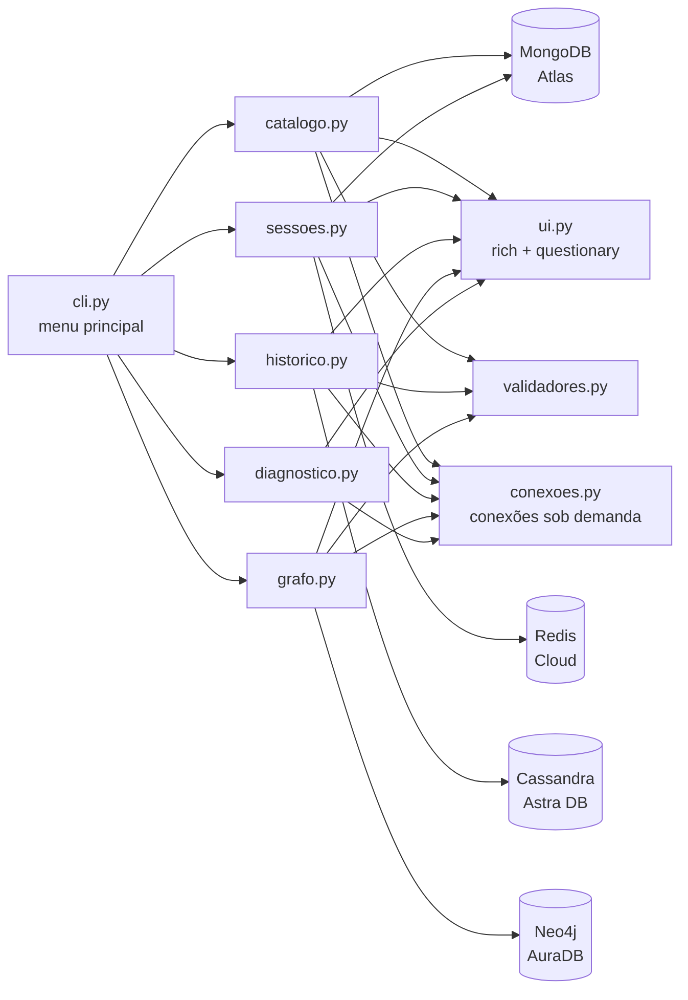
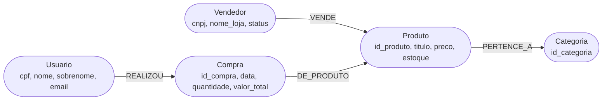

# Mercado Livre — Marketplace com persistência poliglota


Aplicação com **duas interfaces independentes** (terminal e web) que simula o núcleo de um marketplace e usa **o banco de dados certo para cada problema**: MongoDB para o catálogo e os pedidos, Redis para sessões e cache, Cassandra (DataStax Astra DB) para o histórico de compras e Neo4j (AuraDB) para o grafo de relacionamentos entre usuários, vendedores, produtos e compras. A interface é interativa: menus navegáveis por setas, listas com filtro, autocompletar, tabelas formatadas, painel com gráficos e indicadores de progresso.

> **Quer publicar a versão web gratuitamente?** Siga o [Guia de deploy](docs/DEPLOY.md) (Streamlit Community Cloud).
>
> **Vai apresentar o projeto?** Leia o [Guia de apresentação](docs/GUIA_APRESENTACAO.md): explica cada banco em linguagem simples, com roteiro de demonstração e perguntas prováveis.

## Funcionalidades

| Módulo | Banco | O que faz |
|---|---|---|
| **Catálogo e pedidos** | MongoDB | CRUD de usuários, vendedores e produtos; favoritos; pedidos com baixa de estoque atômica; painel com indicadores; busca com autocompletar; filtro por categoria; exportação para CSV; preenchimento de endereço pelo CEP. |
| **Sessões e cache** | Redis | Login com sessão que expira sozinha (TTL deslizante), proteção contra força bruta, contagem regressiva ao vivo e fluxo de cache MongoDB → Redis → MongoDB. |
| **Histórico de compras** | Cassandra | Usuários, vendedores, produtos e compras modelados por consulta, com busca por categoria e prefixo do título e exclusão consistente entre tabelas. |
| **Grafo de compras** | Neo4j | Usuários, vendedores, categorias, produtos e compras como nós ligados por relacionamentos (`VENDE`, `PERTENCE_A`, `REALIZOU`, `DE_PRODUTO`), com busca em todos os tipos de nó, árvores que mostram o caminho usuário → compra → produto → loja e resumo do grafo. |
| **Diagnóstico** | todos | Testa as quatro conexões e mostra status e latência. |

### Destaques da interface

- **Seleção em vez de digitação**: usuários, vendedores e produtos são escolhidos em listas filtráveis, sem copiar CPF ou ObjectId.
- **Validação em tempo real**: CPF, CNPJ, e-mail, CEP, preços e quantidades são validados enquanto o usuário digita.
- **Edição com valores preenchidos**: ao atualizar um registro, os campos já vêm com o valor atual e só o que mudou é gravado.
- **Painel geral**: totais, receita, valor em estoque, ranking de mais vendidos (barras) e alerta de estoque baixo.
- **Cancelamento seguro**: `Ctrl+C` em qualquer pergunta cancela a operação e volta ao menu, sem derrubar a aplicação.

## Arquitetura



Princípios adotados:

- **Conexões sob demanda**: importar um módulo não abre conexão. Quem usa só o MongoDB não precisa dos drivers do Redis ou do Cassandra.
- **Camadas separadas**: validação (`validadores.py`), apresentação (`ui.py`), acesso a dados e regras de cada módulo. Nenhum módulo de domínio usa `print` ou `input` diretamente.
- **Configuração por ambiente**: credenciais ficam no `.env`, nunca no código.

## Interface web

Além da CLI, o projeto tem um dashboard em **Streamlit** que usa os mesmos módulos de negócio, sem duplicar regras.

| Página | Banco | Acesso |
|---|---|---|
| Dashboard | MongoDB + resumo dos demais | todos |
| Produtos | MongoDB | consulta: todos; cadastro/edição/exclusão: admin |
| Vendedores | MongoDB | consulta: todos; gestão: admin |
| Usuários | MongoDB | admin gerencia; usuário vê só o próprio perfil |
| Pedidos | MongoDB | usuário compra em seu nome; admin vê e cria para qualquer comprador |
| Sessões e cache | Redis | consulta: todos (e-mails mascarados); sessão de demonstração: logado; fluxo de cache: admin |
| Histórico de compras | Cassandra | catálogo por categoria/prefixo: todos; compras: do próprio usuário ou admin |
| Grafo | Neo4j | grafo público (lojas, produtos, categorias): todos; compras e usuários: logado/admin |
| Diagnóstico | todos | estado e latência: todos; detalhes técnicos: admin |

**Papéis:** *visitante* (somente leitura, sem dados pessoais), *usuário* (compra e consulta o que é seu) e *administrador*. O papel vem de uma sessão guardada no servidor (Redis, com TTL), nunca do navegador. O cancelamento de pedidos não existe nas regras do núcleo e por isso não é oferecido.

### Executar a web localmente

```bash
pip install -r requirements.txt
cp .env.example .env              # preencha as credenciais dos bancos
# desenvolvimento: contas descartáveis (admin / admin-dev-local). NUNCA em produção.
APP_ENV=development streamlit run web/app.py
```

No Windows (PowerShell): `$env:APP_ENV="development"; streamlit run web/app.py`.

Para o ambiente de produção, defina as contas reais (veja [`docs/DEPLOY.md`](docs/DEPLOY.md)). Gere o hash de uma senha com `python -m web.auth.senhas`.

### Arquitetura em camadas

```
Interface web (web/pages, web/components)
        ↓
Camada de serviços (web/services): papéis, erros, mascaramento, disjuntor
        ↓
Núcleo de negócio (catalogo_dados, sessoes_dados, historico, grafo)   ←  CLI (cli.py, catalogo.py, sessoes.py)
        ↓
Conexões (conexoes.py + config.py): timeouts, pools, Secrets/.env
        ↓
MongoDB · Redis · Cassandra · Neo4j
```

A CLI e a web chamam as **mesmas funções do núcleo**. Para isso, a lógica do MongoDB e do Redis foi extraída dos arquivos de terminal para `catalogo_dados.py` e `sessoes_dados.py` (sem `rich`, `questionary` ou `streamlit`); a CLI virou uma camada fina por cima. Um teste garante que a CLI não importa o Streamlit.

### Segurança e modo demonstração

- **Credenciais** só por ambiente: `.env` (local) ou Secrets do Streamlit (produção). Nada no código; `.env` e `secrets.toml` estão no `.gitignore`.
- **Login:** senhas com PBKDF2-SHA256 (600 mil iterações), comparação em tempo constante, bloqueio por tentativas (reaproveita o contador do Redis) e sessão no servidor com TTL deslizante. O Redis guarda só o *hash* do token.
- **Produção por padrão:** sem `APP_ENV=development`, as contas e senhas de demonstração não existem.
- **Autorização no servidor:** cada operação dos serviços confere o papel; esconder um botão na tela não é a proteção.
- **Exclusões** pedem confirmação explícita; **erros** de banco viram mensagens genéricas (o detalhe vai para o log, sem segredos).
- **Modo demonstração** (`DEMO_MODE=true`): visitantes navegam em somente leitura, com CPF e e-mail ocultos; nenhuma escrita sem login.
- **Disponibilidade:** a aplicação abre mesmo com bancos fora do ar; cada parte afetada mostra "indisponível" e as demais seguem funcionando.

## Estrutura do projeto

```
MercadoLivre/
├── mercadolivre/              # núcleo de negócio + CLI
│   ├── __main__.py            # python -m mercadolivre
│   ├── cli.py                 # menu principal
│   ├── catalogo.py            # CLI do MongoDB (chama catalogo_dados)
│   ├── catalogo_dados.py      # MongoDB: regras de negócio, sem interface
│   ├── sessoes.py             # CLI do Redis (chama sessoes_dados)
│   ├── sessoes_dados.py       # Redis: sessões, tentativas e fluxo de cache, sem interface
│   ├── historico.py           # Cassandra: dados + CLI
│   ├── grafo.py               # Neo4j: dados + CLI (inclui subgrafo para a web)
│   ├── diagnostico.py         # teste das conexões
│   ├── conexoes.py            # fábrica de conexões (lazy, com timeouts e pools)
│   ├── config.py              # ambiente, Secrets e bancos configurados
│   ├── dados_demo.py          # dados de exemplo iguais para os quatro bancos
│   ├── ui.py                  # tabelas, painéis, menus e perguntas (terminal)
│   └── validadores.py         # CPF, CNPJ, e-mail, moeda, datas
├── web/                       # interface web (Streamlit)
│   ├── app.py                 # entrada: navegação, login e papéis
│   ├── state.py               # liga o session_state ao token de sessão
│   ├── pages/                 # 9 páginas
│   ├── services/              # camada de serviços (papéis, erros, disjuntor)
│   ├── auth/                  # senhas, contas, sessão no servidor, permissões
│   ├── components/            # cards, tema, grafo (PyVis), sidebar, layout
│   ├── styles/app.css
│   └── utils/formatacao.py    # moeda, máscaras, HTML seguro
├── .streamlit/                # config.toml e secrets.toml.example
├── docs/                      # GUIA_APRESENTACAO.md e DEPLOY.md
├── tests/                     # CLI/núcleo e tests/web_app (serviços, auth, páginas)
├── .env.example
├── requirements.txt           # produção (núcleo + web)
├── requirements-cli.txt       # só a CLI
├── requirements-dev.txt       # + testes
└── pytest.ini
```

## Tecnologias

| Biblioteca | Uso |
|---|---|
| [PyMongo](https://pymongo.readthedocs.io/) | Driver do MongoDB |
| [redis-py](https://redis-py.readthedocs.io/) | Driver do Redis |
| [cassandra-driver](https://docs.datastax.com/en/developer/python-driver/) | Driver do Cassandra / Astra DB |
| [neo4j](https://neo4j.com/docs/python-manual/current/) | Driver oficial do Neo4j / AuraDB (Cypher parametrizado) |
| [Rich](https://rich.readthedocs.io/) | Tabelas, painéis, árvores, barras, JSON colorido, spinners e progresso |
| [Questionary](https://questionary.readthedocs.io/) | Menus por setas, filtro, autocompletar, senha oculta e confirmação |
| [Requests](https://requests.readthedocs.io/) | Consulta de endereço no ViaCEP |
| [python-dotenv](https://saurabh-kumar.com/python-dotenv/) | Variáveis de ambiente |
| [Streamlit](https://streamlit.io/) | Interface web (páginas, formulários, autenticação por sessão, testes com `AppTest`) |
| [Plotly](https://plotly.com/python/) | Gráficos interativos do dashboard |
| [PyVis](https://pyvis.readthedocs.io/) | Visualização interativa do grafo (arrastar, zoom, tooltip), HTML autossuficiente |
| [pytest](https://docs.pytest.org/), fakeredis, mongomock | Testes sem depender de bancos reais |

## Como executar

### Pré-requisitos

- Python 3.10 a 3.14 (o `cassandra-driver` 3.30.1 não funciona no 3.15)
- Cluster no [MongoDB Atlas](https://www.mongodb.com/atlas) ou MongoDB local
- Base no [Redis Cloud](https://redis.io/try-free/) ou Redis local
- Conta no [DataStax Astra DB](https://astra.datastax.com) (Serverless, non-vector) com o keyspace `mercadolivre` criado pelo painel e o *Secure Connect Bundle* baixado
- Instância gratuita no [Neo4j AuraDB](https://neo4j.com/cloud/platform/aura-graph-database/) (Free) com o arquivo de credenciais `.txt` baixado na criação

Os quatro bancos são independentes: é possível usar apenas os módulos cujos serviços você configurou.

### Instalação

```bash
git clone <url-do-repositorio>
cd MercadoLivre

py -m venv .venv
# Windows
.venv\Scripts\activate
# Linux/macOS
source .venv/bin/activate

py -m pip install -r requirements.txt
```

### Configuração

```bash
cp .env.example .env      # Windows: copy .env.example .env
```

| Variável | Descrição |
|---|---|
| `MONGODB_URI` | String de conexão do MongoDB |
| `MONGODB_DATABASE` | Nome do banco (padrão: `mercadolivre`) |
| `MONGODB_COLLECTION` | Coleção usada no fluxo de cache do Redis (padrão: `produtos`) |
| `REDIS_HOST` / `REDIS_PORT` / `REDIS_PASSWORD` | Dados da base Redis |
| `REDIS_SSL` | `true` somente se o banco tiver TLS habilitado |
| `REDIS_URL` | Alternativa às variáveis acima (tem prioridade) |
| `SESSION_EXPIRATION` | Duração da sessão em segundos (padrão: `60`) |
| `ASTRA_SCB_PATH` | Caminho do `secure-connect-*.zip` |
| `ASTRA_DB_TOKEN` | Token da aplicação no Astra (começa com `AstraCS:`) |
| `ASTRA_KEYSPACE` | Keyspace do Cassandra (padrão: `mercadolivre`) |
| `NEO4J_URI` | URI da instância Aura (`neo4j+s://<id>.databases.neo4j.io`) |
| `NEO4J_USERNAME` | Usuário (padrão: `neo4j`) |
| `NEO4J_PASSWORD` | Senha gerada na criação da instância |
| `NEO4J_DATABASE` | Banco dentro da instância (padrão: `neo4j`) |

> O `.env` e o `secure-connect*.zip` estão no `.gitignore`. **Nunca** envie senhas, tokens ou o bundle do Astra para o repositório. O arquivo `.txt` de credenciais do Aura também contém a senha: guarde-o fora do repositório.

### Execução

```bash
py -m mercadolivre                # menu principal
py -m mercadolivre.catalogo       # abre direto o catálogo (MongoDB)
py -m mercadolivre.sessoes        # abre direto sessões e cache (Redis)
py -m mercadolivre.historico      # abre direto o histórico (Cassandra)
py -m mercadolivre.grafo          # abre direto o grafo de compras (Neo4j)
py -m mercadolivre.diagnostico    # testa as conexões
```

Primeiros passos sugeridos:

1. Rode o **Diagnóstico** para conferir as quatro conexões.
2. No **Catálogo**, use *Carregar dados de demonstração* (ou cadastre um vendedor e dois produtos).
3. Em **Sessões e cache**, faça login e execute o fluxo MongoDB → Redis → MongoDB.
4. No **Histórico**, use *Preparar o keyspace* para criar as tabelas e carregar dados de demonstração.
5. No **Grafo de compras**, use *Preparar o banco* para criar as restrições e os dados de demonstração, depois explore as árvores em *Explorar o grafo*.

Usuários de demonstração do módulo de sessões (apenas desenvolvimento, definidos em `sessoes.py`):

| E-mail | Senha |
|---|---|
| `aluno@fatec.sp.gov.br` | `senha123` |
| `vinicius@gmail.com` | `123456` |

## Modelo de dados

### MongoDB (documentos)

Coleções `usuarios`, `vendedores`, `produtos`, `favoritos` e `pedidos`. Os relacionamentos são feitos por referência (`id_vendedor`, `id_comprador`, `id_produto`) e consultados com `$lookup`. Valores monetários usam `Decimal128`.

Índices: únicos em CPF, CNPJ, nome da loja e no par usuário/produto dos favoritos; compostos para nome do usuário, categoria, vendedor e data do pedido.

### Redis (chave-valor)

| Chave | Conteúdo | Expiração |
|---|---|---|
| `session:<email>` | Sessão do usuário | `SESSION_EXPIRATION` s (renovada a cada ação) |
| `login_falhas:<email>` | Contador de tentativas inválidas | 5 min (bloqueio após 5 falhas) |
| `item_ml:<_id>` | Produto em trânsito do MongoDB (JSON BSON) | removida ao devolver o item |

### Cassandra (colunas)

A modelagem nasce da consulta: cada consulta tem a sua tabela e a mesma informação pode ser gravada em mais de uma (denormalização). As chaves de partição definem em qual nó o dado fica; as de clusterização, a ordem dentro da partição.

| Tabela | Chave | Consulta atendida |
|---|---|---|
| `usuario` | `cpf` | dados do usuário |
| `vendedor` | `cnpj` | dados do vendedor |
| `produto` | `id_produto` | dados de um produto |
| `produto_por_categoria` | `((id_categoria), titulo, id_produto)` | produtos de uma categoria em ordem de título |
| `compra` | `id_compra` | dados de uma compra |
| `compra_por_usuario` | `((cpf), data_compra DESC, id_compra)` | compras de um usuário, da mais nova para a mais antiga |

### Neo4j (grafo)

Os dados são nós com rótulo e propriedades, ligados por relacionamentos direcionados. Em vez de repetir um identificador dentro de outro registro (MongoDB) ou duplicar a informação em várias tabelas (Cassandra), a ligação é uma aresta e a consulta a percorre.



| Nó | Chave única | Busca disponível |
|---|---|---|
| `Usuario` | `cpf` | por CPF; por trecho do nome, e-mail ou CPF |
| `Vendedor` | `cnpj` (e `nome_loja`) | por CNPJ; por trecho do nome da loja ou CNPJ, com contagem de produtos |
| `Produto` | `id_produto` | por id (com loja e categoria); por trecho do título, categoria e loja, com ordenação |
| `Compra` | `id_compra` | por id (com comprador, produto e loja); por usuário, por produto ou todas |
| `Categoria` | `id_categoria` | lista de categorias existentes |

Cada chave única é uma restrição (`CREATE CONSTRAINT ... IS UNIQUE`), que também cria o índice usado pelas consultas. Há ainda índices para `Usuario.nome` e `Produto.titulo`.

## Decisões de projeto

- **Menu único**: todos os módulos usam o mesmo laço de menu (`ui.menu`) e os mesmos dados de exemplo (`dados_demo.py`), sem código repetido.
- **Estoque atômico (MongoDB)**: a baixa usa `update_one` com condição `quantidade_disponivel >= qtd`, evitando venda acima do estoque em pedidos simultâneos. Se a gravação do pedido falhar, a baixa é desfeita.
- **Escritas em duas tabelas (Cassandra)**: produto e compra são gravados em `BatchStatement`, mantendo as tabelas denormalizadas consistentes. Usuário e vendedor usam `IF NOT EXISTS` e a atualização usa `IF EXISTS`, porque no Cassandra INSERT e UPDATE são upserts.
- **Prepared statements em cache**: cada instrução CQL é preparada uma única vez.
- **Gravação idempotente (Neo4j)**: usuários, vendedores e produtos usam `MERGE` pela chave com `ON CREATE SET`. Repetir uma carga não duplica nós nem sobrescreve dados, e o contador de nós criados informa se o cadastro foi novo ou já existia.
- **Compra transacional (Neo4j)**: nó da compra, relacionamentos e baixa de estoque são gravados na mesma transação. O produto é bloqueado para escrita antes de o saldo ser conferido, e a compra recusa quantidades acima do estoque. Título e preço são copiados para a compra, preservando o histórico se o produto mudar depois.
- **Preços em `float` no grafo (Neo4j)**: o Neo4j não tem tipo decimal. Os valores são calculados em `Decimal` na aplicação, gravados como `float` com duas casas e convertidos de volta para `Decimal` na leitura.
- **Fluxo de cache à prova de falhas**: o item é registrado para devolução antes de ser removido do MongoDB, e a devolução roda em `finally`. Nenhum documento se perde se algo falhar no meio.
- **Sessão deslizante**: cada ação renova o TTL; ao expirar, o Redis apaga a chave sozinho.
- **Senhas comparadas em tempo constante** (`hmac.compare_digest`) e bloqueio temporário após tentativas inválidas.

## Testes

```bash
pip install -r requirements-dev.txt
pytest
```

Os testes usam `fakeredis` e `mongomock`, portanto rodam sem nenhum banco real. Cobrem validadores, regras de pedido e estoque, sessões (login, bloqueio, TTL), o fluxo de cache e a geração das consultas CQL e Cypher. Os testes da web (`tests/web_app`) cobrem configuração, autenticação e autorização, isolamento entre usuários, mascaramento de dados, tratamento de falhas e comportamento com bancos indisponíveis, incluindo as páginas executadas com `streamlit.testing.v1.AppTest`.

**Limites do que é testado:** Cassandra e Neo4j não têm simulador nos testes; a geração das consultas e a degradação sem o serviço são testadas, mas o comportamento contra Astra DB e AuraDB reais só pode ser validado com as suas credenciais. O `mongomock` não suporta `$multiply` com `Decimal128`, então o cálculo do valor em estoque é validado apenas no MongoDB real.

## Segurança

- Credenciais apenas em variáveis de ambiente (`.env` fora do controle de versão).
- Consultas CQL e Cypher sempre parametrizadas; no Neo4j, o único trecho montado dinamicamente é o `ORDER BY`, escolhido em uma lista fixa de expressões. No MongoDB, buscas por texto usam `re.escape`.
- Dados digitados pelo usuário são escapados antes de serem exibidos no terminal.
- Os usuários de demonstração do módulo de sessões da **CLI** existem apenas para desenvolvimento. A **web** usa contas configuradas por ambiente, com hash PBKDF2, e em produção as contas de demonstração não são carregadas (veja *Segurança e modo demonstração*).

## Próximos passos

- Autenticação real com hash de senha (bcrypt/argon2) integrada à base de usuários.
- Cancelamento e devolução de pedidos com reposição de estoque.
- Avaliações de vendedores e produtos.
- Recomendações a partir do grafo ("quem comprou este produto também comprou").
- Pipeline de CI executando os testes a cada commit.
