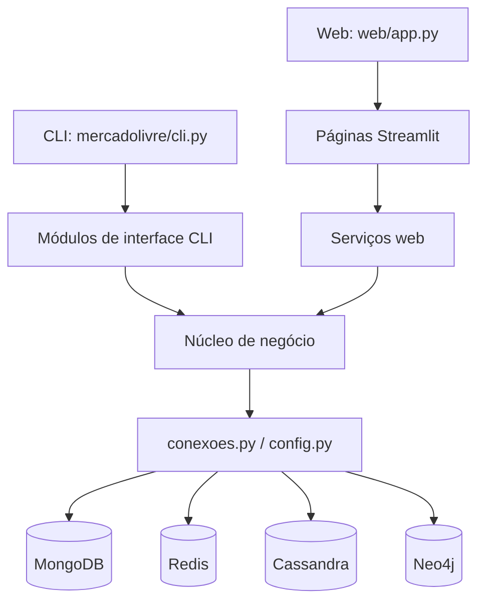
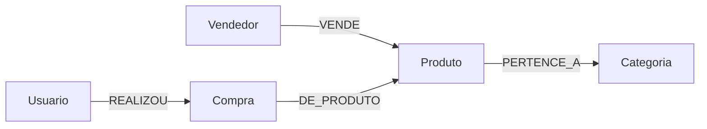

# Mercado Livre — Marketplace com persistência poliglota


Aplicação que simula o núcleo de um marketplace, com duas interfaces independentes: **terminal (CLI)** e **web (Streamlit)**. O projeto utiliza persistência poliglota: cada banco é escolhido de acordo com o tipo de dado e as consultas que precisa atender.

- **MongoDB:** catálogo, usuários, vendedores, favoritos e pedidos.
- **Redis:** sessões, proteção contra tentativas de login e demonstração de cache.
- **Cassandra (DataStax Astra DB):** histórico de compras e consultas organizadas por categoria e usuário.
- **Neo4j (AuraDB):** grafo de relacionamentos entre usuários, vendedores, produtos, categorias e compras.

A CLI oferece menus interativos. A interface web oferece dashboard, páginas de gerenciamento, autenticação e visualização do grafo.

> **Apresentação acadêmica:** consulte o [Guia de apresentação](docs/GUIA_APRESENTACAO.md), que explica os bancos, as decisões de modelagem e o roteiro de demonstração.
>
> **Publicação da interface web:** consulte o [Guia de deploy](docs/DEPLOY.md).

---

## Sumário

- [Funcionalidades](#funcionalidades)
- [Arquitetura](#arquitetura)
- [Tecnologias](#tecnologias)
- [Pré-requisitos](#pré-requisitos)
- [Instalação](#instalação)
- [Configuração dos bancos](#configuração-dos-bancos)
- [Executar pelo terminal](#executar-pelo-terminal)
- [Executar a interface web](#executar-a-interface-web)
- [Dados de demonstração](#dados-de-demonstração)
- [Modelo de dados](#modelo-de-dados)
- [Testes](#testes)
- [Segurança](#segurança)
- [Estrutura do projeto](#estrutura-do-projeto)
- [Solução de problemas](#solução-de-problemas)
- [Documentação complementar](#documentação-complementar)

## Funcionalidades

| Módulo | Banco | Funcionalidades |
|---|---|---|
| Catálogo e pedidos | MongoDB | CRUD de usuários, vendedores e produtos; favoritos; pedidos; controle de estoque; indicadores; busca e filtros; exportação CSV; consulta de endereço pelo CEP. |
| Sessões e cache | Redis + MongoDB | Login com sessão expirada por TTL deslizante; proteção contra força bruta; acompanhamento da sessão; fluxo de cache MongoDB → Redis → MongoDB. |
| Histórico de compras | Cassandra | Cadastro e consulta de usuários, vendedores, produtos e compras; busca por categoria e prefixo do título. |
| Grafo de compras | Neo4j | Nós e relacionamentos; buscas por usuários, lojas, produtos e compras; exploração dos caminhos entre comprador, compra, produto e vendedor. |
| Diagnóstico | Todos | Verificação das conexões, disponibilidade e latência dos bancos. |

### Interface web

A interface web utiliza os mesmos módulos de negócio da CLI. As regras de negócio não são duplicadas na camada visual.

| Página | Banco principal | Acesso |
|---|---|---|
| Dashboard | MongoDB e resumo dos demais | Conforme papel |
| Produtos | MongoDB | Consulta pública; gestão por administrador |
| Vendedores | MongoDB | Consulta pública; gestão por administrador |
| Usuários | MongoDB | Conforme papel e propriedade dos dados |
| Pedidos | MongoDB | Usuário compra em seu nome; administrador gerencia |
| Favoritos | MongoDB | Usuário gerencia os próprios favoritos; administrador gerencia os de qualquer usuário |
| Sessões e cache | Redis e MongoDB | Conforme papel |
| Histórico de compras | Cassandra | Catálogo público; compras próprias ou administração |
| Grafo | Neo4j | Grafo público e dados restritos conforme autenticação |
| Diagnóstico | Todos | Status disponível; detalhes técnicos conforme papel |

**Papéis da aplicação web:**

- **Visitante:** navegação de leitura, com dados pessoais mascarados quando o modo de demonstração está habilitado.
- **Usuário:** realiza compras em seu próprio nome e consulta os próprios dados.
- **Administrador:** gerencia os recursos da aplicação.

A autorização é verificada no servidor, e não apenas pela exibição ou ocultação de botões.

## Arquitetura



### Organização em camadas

- **Interface:** menus e apresentação no terminal (`ui.py`) e páginas/componentes na web (`web/`).
- **Núcleo de negócio:** regras e operações de cada banco.
- **Serviços web:** autenticação, autorização, tratamento de erros e funcionalidades de suporte.
- **Conexões:** criação e reutilização dos clientes de banco, com configuração centralizada.

### Decisões arquiteturais

- **Conexões sob demanda (lazy):** importar um módulo não abre automaticamente conexão com todos os bancos.
- **Separação entre interface e negócio:** `catalogo_dados.py` e `sessoes_dados.py` concentram regras reutilizadas pela CLI e pela web.
- **Configuração externa:** credenciais são obtidas por `.env` local ou Secrets no Streamlit.
- **Tolerância a indisponibilidade:** a aplicação pode iniciar mesmo quando algum banco não está disponível; as funcionalidades dependentes daquele serviço podem ficar indisponíveis.

## Tecnologias

| Tecnologia | Finalidade |
|---|---|
| Python | Linguagem principal |
| PyMongo | Acesso ao MongoDB |
| redis-py | Acesso ao Redis |
| cassandra-driver | Acesso ao Cassandra / Astra DB |
| Neo4j Python Driver | Acesso ao Neo4j / AuraDB |
| Rich | Tabelas, painéis, progresso e saída formatada no terminal |
| Questionary | Menus interativos, seleção e perguntas no terminal |
| Requests | Consulta de CEP pelo ViaCEP |
| python-dotenv | Carregamento de variáveis do arquivo `.env` |
| Streamlit | Interface web |
| Plotly | Gráficos do dashboard |
| PyVis | Visualização interativa do grafo |
| pytest | Testes automatizados |
| fakeredis | Simulação do Redis nos testes |
| mongomock | Simulação do MongoDB nos testes |

## Pré-requisitos

- Python **3.10 a 3.14**.
- Git.
- Acesso aos bancos que serão utilizados:
  - MongoDB Atlas ou MongoDB local;
  - Redis Cloud ou Redis local;
  - DataStax Astra DB (Cassandra);
  - Neo4j AuraDB ou Neo4j local.

**Recomendação:** utilize Python 3.12 para seguir um ambiente de referência comum ao projeto. O `cassandra-driver` está fixado em `3.30.1`; a dependência `pyasyncore` é declarada para Python 3.12 ou superior.

Os quatro bancos são independentes. Você pode executar módulos isolados, desde que configure o banco exigido por aquele módulo. O diagnóstico geral, por outro lado, verifica os quatro.

## Instalação

### 1. Clonar o repositório

```bash
git clone https://github.com/tirolasca/MercadoLivre.git
cd MercadoLivre
```

### 2. Criar o ambiente virtual

**Windows (PowerShell):**

```powershell
py -3.14 -m venv .venv
.\.venv\Scripts\Activate.ps1
```

Se o PowerShell bloquear a ativação do ambiente, execute a política apenas para o processo atual:

```powershell
Set-ExecutionPolicy -Scope Process -ExecutionPolicy Bypass
.\.venv\Scripts\Activate.ps1
```

**Linux/macOS:**

```bash
python3 -m venv .venv
source .venv/bin/activate
```

### 3. Atualizar o instalador e instalar as dependências

Para executar **CLI e interface web**:

```bash
py -m pip install --upgrade pip
py -m pip install -r requirements.txt
```

Para instalar somente a **CLI e o núcleo de negócio**:

```bash
py -m pip install --upgrade pip
py -m pip install -r requirements-cli.txt
```

Para instalar também as ferramentas de **testes e desenvolvimento**:

```bash
py -m pip install -r requirements-dev.txt
```

> `requirements.txt` já inclui `requirements-cli.txt`. `requirements-dev.txt` inclui `requirements.txt` e acrescenta as dependências de testes. Não é necessário instalar os três arquivos em sequência.

### 4. Conferir a instalação

```bash
py --version
py -m pip --version
py -m pip check
```

O comando `pip check` verifica conflitos entre dependências instaladas.

## Configuração dos bancos

### 1. Criar o arquivo `.env`

Na raiz do projeto:

**Windows (PowerShell):**

```powershell
Copy-Item .env.example .env
```

**Linux/macOS:**

```bash
cp .env.example .env
```

Edite o `.env` e preencha somente as credenciais dos bancos que pretende utilizar.

### 2. Variáveis de ambiente

| Variável | Banco | Descrição |
|---|---|---|
| `MONGODB_URI` | MongoDB | URI de conexão |
| `MONGODB_DATABASE` | MongoDB | Banco utilizado (padrão: `mercadolivre`) |
| `MONGODB_COLLECTION` | MongoDB/Redis | Coleção usada no fluxo de cache (padrão: `produtos`) |
| `REDIS_HOST` | Redis | Host do servidor |
| `REDIS_PORT` | Redis | Porta do servidor |
| `REDIS_PASSWORD` | Redis | Senha |
| `REDIS_SSL` | Redis | Habilita TLS quando configurado como `true` |
| `REDIS_URL` | Redis | URI alternativa; tem prioridade sobre host/porta/senha |
| `SESSION_EXPIRATION` | Redis | Duração da sessão da CLI em segundos (padrão: `60`) |
| `ASTRA_SCB_PATH` | Cassandra | Caminho do Secure Connect Bundle |
| `ASTRA_SCB_B64` | Cassandra | Secure Connect Bundle em base64; alternativa ao caminho do arquivo |
| `ASTRA_DB_TOKEN` | Cassandra | Token de aplicação do Astra DB |
| `ASTRA_KEYSPACE` | Cassandra | Keyspace (padrão: `mercadolivre`) |
| `NEO4J_URI` | Neo4j | URI da instância |
| `NEO4J_USERNAME` | Neo4j | Usuário (padrão: `neo4j`) |
| `NEO4J_PASSWORD` | Neo4j | Senha da instância |
| `NEO4J_DATABASE` | Neo4j | Banco (padrão: `neo4j`) |
| `APP_ENV` | Web | Ambiente `production` ou `development` (padrão: `production`) |
| `DEMO_MODE` | Web | Habilita navegação pública em modo de demonstração (padrão: `true`) |
| `WEB_SESSION_TTL` | Web | Duração da sessão web em segundos (padrão: `1800`) |

Há também limites opcionais para os pools de conexão: `MONGODB_MAX_POOL`, `REDIS_MAX_CONNECTIONS` e `NEO4J_MAX_POOL`.

### 3. Configurar cada serviço

**MongoDB Atlas**
1. Crie um cluster e um usuário de banco.
2. Libere o acesso de rede do ambiente em que a aplicação será executada.
3. Copie a connection string para `MONGODB_URI`.
4. Configure `MONGODB_DATABASE=mercadolivre`, se desejar explicitar o padrão.

**Redis Cloud**
1. Crie uma base Redis.
2. Copie host, porta e senha para as variáveis correspondentes.
3. Se o provedor exigir TLS, configure `REDIS_SSL=true`.
4. Alternativamente, informe a URI completa em `REDIS_URL`.

**DataStax Astra DB**
1. Crie um banco Cassandra Serverless.
2. Crie o keyspace `mercadolivre` no painel do Astra.
3. Gere um token com permissões suficientes para criar e manipular tabelas.
4. Baixe o Secure Connect Bundle e informe seu caminho em `ASTRA_SCB_PATH`.
5. Informe o token em `ASTRA_DB_TOKEN`.

O código cria as tabelas utilizadas pelo projeto, mas o keyspace precisa existir previamente.

**Neo4j AuraDB**
1. Crie uma instância AuraDB.
2. Guarde a senha gerada pelo provedor.
3. Configure `NEO4J_URI`, `NEO4J_USERNAME` e `NEO4J_PASSWORD`.
4. O banco padrão é `neo4j`; altere `NEO4J_DATABASE` somente se sua instância utilizar outro nome.

> **Segurança:** nunca publique o `.env`, tokens, senhas, o Secure Connect Bundle ou o arquivo de credenciais do AuraDB. O `.gitignore` já exclui esses arquivos. O `.env.example` contém apenas valores ilustrativos.

## Executar pelo terminal

Com o ambiente virtual ativado e as dependências instaladas, execute os comandos a partir da raiz do projeto.

### Menu principal

```bash
py -m mercadolivre
```

Esse comando inicia o menu principal e permite acessar os módulos disponíveis.

### Executar módulos individualmente

```bash
# Catálogo e pedidos — MongoDB
py -m mercadolivre.catalogo

# Sessões e cache — Redis + MongoDB
py -m mercadolivre.sessoes

# Histórico de compras — Cassandra
py -m mercadolivre.historico

# Grafo de compras — Neo4j
py -m mercadolivre.grafo

# Diagnóstico das conexões
py -m mercadolivre.diagnostico
```

No Windows, os mesmos comandos funcionam no PowerShell com o ambiente virtual ativado. Também é possível usar `py -3.14 -m ...` caso o Python Launcher esteja instalado.

### Ordem sugerida para a primeira demonstração

1. Configure as credenciais dos bancos que serão demonstrados.
2. Execute `py -m mercadolivre.diagnostico` para verificar as conexões.
3. Abra o catálogo e cadastre um vendedor e produtos ou utilize a opção de dados de demonstração.
4. Abra sessões e cache, faça login e demonstre o fluxo MongoDB → Redis → MongoDB.
5. Prepare o keyspace/tabelas do Cassandra pelo módulo de histórico e carregue os dados de demonstração.
6. Prepare o banco Neo4j pelo módulo de grafo e explore os nós e relacionamentos.

As opções exatas de preparação e carga são apresentadas pelos menus de cada módulo.

### Usuários de demonstração da CLI

O módulo Redis possui contas de demonstração definidas em `mercadolivre/sessoes_dados.py`:

| E-mail | Senha |
|---|---|
| `aluno@fatec.sp.gov.br` | `senha123` |
| `vinicius@gmail.com` | `123456` |

Essas credenciais são destinadas à demonstração local da **CLI**. Elas não são as contas de autenticação da interface web e não devem ser utilizadas em produção.

## Executar a interface web

A interface web utiliza Streamlit e os mesmos módulos de negócio da CLI.

### 1. Instalar as dependências web

Se ainda não instalou as dependências completas:

```bash
py -m pip install -r requirements.txt
```

### 2. Configurar o ambiente de desenvolvimento

O ambiente padrão é `production`. Para habilitar as contas descartáveis de desenvolvimento da interface web, defina `APP_ENV=development`.

**Windows (PowerShell):**

```powershell
$env:APP_ENV = "development"
streamlit run web/app.py
```

**Linux/macOS:**

```bash
APP_ENV=development streamlit run web/app.py
```

Acesse o endereço local exibido pelo Streamlit, normalmente `http://localhost:8501`.

> As contas descartáveis de desenvolvimento existem somente para facilitar testes locais. Nunca utilize `APP_ENV=development` em uma publicação pública.

### 3. Autenticação da web

A autenticação web é independente das contas de demonstração da CLI. Para configurar contas próprias:

```bash
py -m web.auth.senhas
```

O comando solicita uma senha e gera um hash PBKDF2-SHA256 para ser utilizado na configuração de `AUTH_USUARIOS` ou dos Secrets do Streamlit. Não coloque a senha em texto puro no repositório.

Para publicar a aplicação, consulte [docs/DEPLOY.md](docs/DEPLOY.md).

## Dados de demonstração

O módulo `mercadolivre/dados_demo.py` centraliza dados de exemplo utilizados para demonstrar os bancos.

A carga de dados deve ser realizada pelos recursos de cada módulo. Antes de executar uma demonstração, confira se o banco está conectado e se a opção de preparação necessária foi concluída.

A carga de dados pode criar registros persistentes nos serviços configurados. Utilize bancos de desenvolvimento ou dados de teste quando estiver experimentando.

## Modelo de dados

### MongoDB — banco orientado a documentos

Coleções principais:

- `usuarios` (guarda, dentro do próprio documento, os `enderecos` e os `favoritos`)
- `vendedores`
- `produtos`
- `pedidos`

Os favoritos ficam **dentro do documento do usuário**, como uma lista de `{id_produto, criado_em}`; o `$push` só acontece se o produto ainda não estiver na lista, então nada é duplicado. Os demais documentos referenciam outros registros por identificadores, como `id_vendedor`, `id_comprador` e `id_produto`. Consultas que precisam combinar coleções utilizam recursos de agregação, incluindo `$lookup`.

Valores monetários são representados com `Decimal128`. Índices únicos protegem campos como CPF, CNPJ e nome da loja, e um índice em `favoritos.id_produto` para localizar quem favoritou cada produto. Há também índices para consultas frequentes.

> **Migração:** bancos criados com o modelo antigo (coleção `favoritos` separada) são convertidos automaticamente na próxima execução de `configurar_banco_dados()` (por exemplo, ao carregar os dados de demonstração). A conversão é idempotente: descarta duplicados e favoritos de usuários/produtos que não existem mais e remove a coleção antiga.

**Por que MongoDB?** O catálogo possui documentos com atributos próprios e operações de cadastro, atualização e consulta. O modelo documental permite organizar esses dados sem exigir que todas as entidades tenham exatamente a mesma estrutura.

### Redis — banco chave-valor

Principais chaves utilizadas:

| Chave | Conteúdo | Expiração |
|---|---|---|
| `session:<email>` | Sessão do usuário | TTL configurável e renovado a cada ação válida |
| `login_falhas:<email>` | Contador de tentativas inválidas | 5 minutos; bloqueio após 5 falhas |
| `item_ml:<_id>` | Produto temporariamente movido do MongoDB | Removida ao devolver o item |

**Por que Redis?** Sessões, contadores e dados temporários exigem leitura e escrita rápidas. O TTL permite que informações temporárias expirem automaticamente.

### Cassandra — banco orientado a colunas

A modelagem é orientada às consultas. Em vez de depender de junções entre tabelas, os dados podem ser repetidos em estruturas diferentes para atender padrões de leitura específicos.

| Tabela | Chave principal | Consulta atendida |
|---|---|---|
| `usuario` | `cpf` | Dados de um usuário |
| `vendedor` | `cnpj` | Dados de um vendedor |
| `produto` | `id_produto` | Dados de um produto |
| `produto_por_categoria` | `((id_categoria), titulo, id_produto)` | Produtos de uma categoria ordenados por título |
| `compra` | `id_compra` | Dados de uma compra |
| `compra_por_usuario` | `((cpf), data_compra DESC, id_compra)` | Compras de um usuário, da mais recente para a mais antiga |

**Por que Cassandra?** O histórico de compras pode crescer bastante e possui consultas previsíveis. A modelagem por consulta e a distribuição dos dados são adequadas para esse tipo de cenário.

### Neo4j — banco orientado a grafos

Os principais nós são:

- `Usuario`
- `Vendedor`
- `Produto`
- `Categoria`
- `Compra`

Relacionamentos:



As chaves únicas são protegidas por restrições (`CREATE CONSTRAINT ... IS UNIQUE`). Também existem índices para propriedades utilizadas em buscas.

**Por que Neo4j?** O grafo representa relações diretamente. É possível percorrer caminhos entre compradores, compras, produtos, vendedores e categorias sem reconstruir manualmente essas conexões em várias consultas relacionais.

## Decisões de implementação

- **Estoque atômico no MongoDB:** a atualização condiciona a baixa à quantidade disponível, evitando que pedidos simultâneos vendam mais unidades do que existem.
- **Consistência em operações do catálogo:** se a gravação do pedido falhar após a baixa, o código possui fluxo para desfazer a alteração.
- **Cassandra modelado por consulta:** tabelas diferentes atendem padrões de leitura distintos; operações relacionadas utilizam `BatchStatement` quando aplicável.
- **Prepared statements:** instruções CQL são preparadas e reutilizadas.
- **Neo4j com `MERGE`:** a carga de dados pode ser repetida sem criar duplicatas para as mesmas chaves.
- **Compra transacional no Neo4j:** criação da compra, relacionamentos e atualização do estoque são tratados na mesma transação.
- **Parâmetros nas consultas:** valores de entrada são enviados como parâmetros nas consultas CQL e Cypher.
- **Sessão deslizante:** ações válidas renovam o TTL da sessão.
- **Proteção de login:** tentativas inválidas são contabilizadas e podem provocar bloqueio temporário.
- **Fluxo de cache com recuperação:** os itens movidos do MongoDB para o Redis são devolvidos no bloco `finally`, inclusive quando ocorre uma falha durante o processamento.

## Testes

Os testes automatizados utilizam `pytest`, `fakeredis` e `mongomock`. Não é necessário conectar aos serviços reais para executar a suíte de testes.

### Executar todos os testes

```bash
py -m pip install -r requirements-dev.txt
py -m pytest
```

### Executar um arquivo específico

```bash
py -m pytest tests/test_catalogo.py
py -m pytest tests/test_sessoes.py
py -m pytest tests/test_historico.py
py -m pytest tests/test_grafo.py
py -m pytest tests/test_validadores.py
```

### Executar os testes da interface web

```bash
py -m pytest tests/web_app/
```

A suíte web cobre configuração, autenticação, componentes, páginas e serviços. Os testes de páginas utilizam `streamlit.testing.v1.AppTest`.

### Limites dos testes

- Cassandra e Neo4j não possuem simuladores equivalentes aos utilizados para MongoDB e Redis nesta suíte. Os testes verificam partes da lógica e da geração de consultas, mas não substituem uma validação com Astra DB e AuraDB reais.
- `mongomock` não reproduz integralmente todos os comportamentos do MongoDB real, especialmente algumas operações de agregação e tipos BSON.
- Testes automatizados não substituem a verificação visual da interface em navegadores e tamanhos de tela diferentes.

## Segurança

- Credenciais devem ficar em `.env` local ou Secrets do Streamlit.
- O `.gitignore` exclui `.env`, bundles do Astra e `secrets.toml`.
- A web utiliza hashes PBKDF2-SHA256 para senhas, comparação em tempo constante e sessões armazenadas no servidor.
- A autorização é conferida na camada de serviços, e não apenas na interface.
- Consultas CQL e Cypher utilizam parâmetros para os valores recebidos.
- Dados pessoais são mascarados no modo de demonstração.
- O ambiente de produção é o padrão; contas descartáveis de desenvolvimento não devem ser habilitadas em produção.

Se uma credencial for publicada acidentalmente, removê-la do arquivo não é suficiente: revogue ou rotacione a credencial no provedor correspondente.

## Estrutura do projeto

```text
MercadoLivre/
├── .github/
│   ├── dependabot.yml
│   └── workflows/
│       └── codeql.yml
├── .streamlit/
│   ├── config.toml
│   └── secrets.toml.example
├── docs/
│   ├── DEPLOY.md
│   └── GUIA_APRESENTACAO.md
├── mercadolivre/
│   ├── __init__.py
│   ├── __main__.py
│   ├── cli.py
│   ├── catalogo.py
│   ├── catalogo_dados.py
│   ├── sessoes.py
│   ├── sessoes_dados.py
│   ├── historico.py
│   ├── grafo.py
│   ├── diagnostico.py
│   ├── conexoes.py
│   ├── config.py
│   ├── dados_demo.py
│   ├── ui.py
│   └── validadores.py
├── tests/
│   ├── conftest.py
│   ├── test_catalogo.py
│   ├── test_demo.py
│   ├── test_grafo.py
│   ├── test_historico.py
│   ├── test_sessoes.py
│   ├── test_validadores.py
│   └── web_app/
│       ├── conftest.py
│       ├── test_auth.py
│       ├── test_componentes.py
│       ├── test_config.py
│       ├── test_paginas.py
│       └── test_servicos.py
├── web/
│   ├── app.py
│   ├── state.py
│   ├── auth/
│   ├── components/
│   ├── paginas/
│   ├── services/
│   ├── static/
│   ├── styles/
│   └── utils/
├── .env.example
├── .gitignore
├── pytest.ini
├── requirements-cli.txt
├── requirements-dev.txt
├── requirements.txt
└── README.md
```

## Solução de problemas

| Problema | Possível causa | Solução |
|---|---|---|
| `python` não é reconhecido | Python não está no PATH | Reinstale/ajuste o PATH ou use `py -3.12` no Windows |
| Erro ao ativar `.venv` no PowerShell | Política de execução | Use `Set-ExecutionPolicy -Scope Process -ExecutionPolicy Bypass` e tente novamente |
| `ModuleNotFoundError` | Dependências ausentes ou ambiente virtual não ativado | Ative `.venv` e instale o arquivo de requirements adequado |
| Erro de conexão MongoDB | URI, senha ou liberação de rede incorreta | Confira `MONGODB_URI` e as regras de acesso do Atlas |
| Erro de conexão Redis | Host, porta, senha ou TLS incorretos | Confira `REDIS_HOST`, `REDIS_PORT`, `REDIS_PASSWORD` e `REDIS_SSL` |
| Cassandra não conecta | Token, bundle ou keyspace ausente | Confira `ASTRA_DB_TOKEN`, `ASTRA_SCB_PATH`/`ASTRA_SCB_B64` e `ASTRA_KEYSPACE` |
| Neo4j não conecta | Instância pausada ou credenciais incorretas | Confira a instância no Aura e as variáveis `NEO4J_*` |
| Erro ao instalar `cassandra-driver` | Versão de Python ou ambiente incompatível | Utilize uma versão suportada entre Python 3.10 e 3.14; Python 3.12 é a recomendação deste guia |
| Web não permite login | Contas não configuradas no ambiente de produção | Configure as contas e seus hashes conforme o guia de deploy |

Para conferir conflitos entre pacotes:

```bash
py -m pip check
```

Para conferir quais arquivos estão sendo rastreados pelo Git e evitar publicar segredos:

```bash
git status
git ls-files
```

## Documentação complementar

- [Guia de apresentação](docs/GUIA_APRESENTACAO.md)
- [Guia de deploy da interface web](docs/DEPLOY.md)
- [Documentação do MongoDB](https://www.mongodb.com/docs/)
- [Documentação do Redis](https://redis.io/docs/)
- [Documentação do Apache Cassandra](https://cassandra.apache.org/doc/latest/)
- [Documentação do Neo4j](https://neo4j.com/docs/)
- [Documentação do Streamlit](https://docs.streamlit.io/)
- [Documentação do pytest](https://docs.pytest.org/)

---

Desenvolvido para fins acadêmicos e de demonstração de persistência poliglota.
